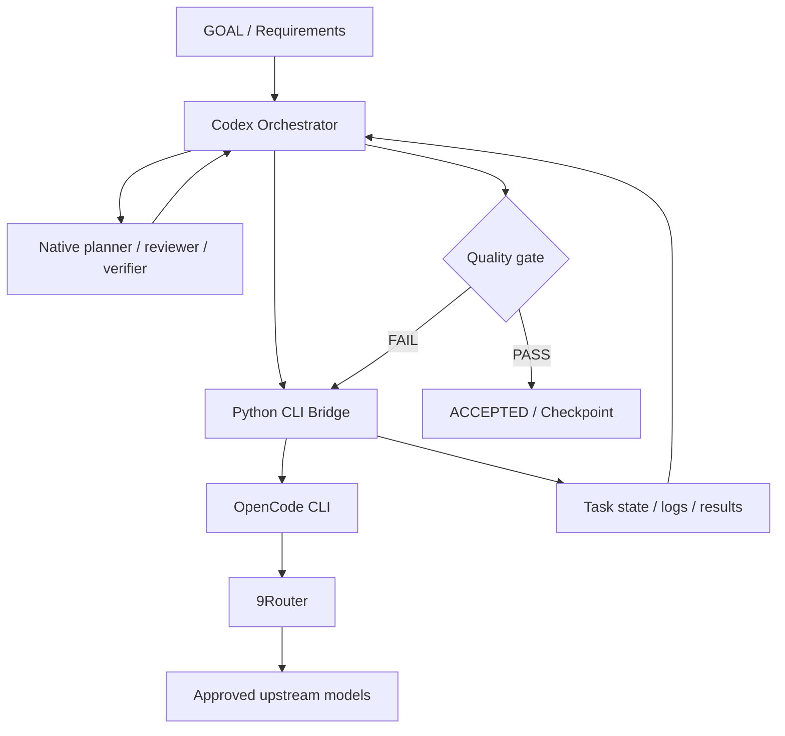

# RUNBOOK — Hybrid Agent CLI Bridge

**Version:** 0.1 | **Ngày:** 26/11/2026 | **Target:** Windows / PowerShell / Codex CLI / OpenCode CLI / 9Router

**Mục đích:** Triển khai thử nghiệm một workflow hybrid có thể tái sử dụng, trong đó Codex điều phối native subagents và external OpenCode agents thông qua Python CLI Bridge. Đây là runbook triển khai, không phải bridge đã được cài đặt hoặc kiểm thử trên máy người dùng.

## 1. Kiến trúc và nguyên tắc



- Codex là authority duy nhất quyết định phân rã task, correction và acceptance; bridge không tự điều phối nghiệp vụ.
- External worker là một lần chạy OpenCode độc lập; không phải native subagent của Codex.
- Bản đầu: synchronous, một writer mỗi repository, không tạo worktree, không commit/push tự động, không MCP, không daemon, không Redis/queue.
- Task/attempt độc lập; dùng model đã đăng ký, không tự chuyển sang Zen hoặc provider ngoài danh sách được duyệt.
- Router có thể fallback trong combo; không coi fallback là bằng chứng đã chạy đúng một model cụ thể. Quota upstream vẫn tồn tại.
- Tác vụ ghi code chỉ chạy sau khi user đã cho phép gửi nội dung repository tới provider tương ứng. Không gửi credentials, file bí mật, dữ liệu production. Sandbox, OS ACL và policy phải được tôn trọng.
- Các file scope trong task contract chỉ là policy; cần kiểm soát runtime/OS nếu muốn cưỡng chế. Kiểm tra diff sau chạy không phải sandbox.

### Phân vai mặc định

| Vai trò | Runtime | Quyền | Nhiệm vụ |
|---|---|---|---|
| Orchestrator | Codex | điều phối | GOAL, task graph, quality gate |
| Planner/Architect | Native | đọc | kế hoạch, dependency, contract |
| Explorer | OpenCode | đọc | khảo sát codebase |
| Coder | OpenCode | ghi có phạm vi | implement, test liên quan |
| Reviewer | OpenCode hoặc native | đọc | independent review |
| Verifier | Native | đọc + kiểm thử được duyệt | xác minh độc lập |

Model ID native lấy từ CLI/config thực tế. Không hardcode tên Luna trên UI. Bản đầu chỉ cần 1 route đã kiểm chứng; phân vai model ở P05 nếu cần.

## 2. Roadmap và gates

| Phase | Mục tiêu | Gate | Bắt buộc? |
|---|---|---|---|
| P00 | Environment & routing preflight | Host và Codex gọi được cùng runtime | Có |
| P01 | Direct CLI proof of concept | Read/write/test fixture qua 9Router | Có |
| P02 | Minimal synchronous CLI Bridge | Task → process → structured result | Có |
| P03 | Safety, reliability & evidence | Timeout, lock, scope, failure tests | Có |
| P04 | Codex hybrid orchestration | Native + external chạy một task end-to-end | Có |
| P05 | Checkpoint, recovery, correction | Resume sau lỗi, bounded loop | Có trước pilot |
| P06 | Pilot repository | Một task nhỏ thực tế được ACCEPTED | Có |
| P07 | Optional async/parallel extension | Process lifecycle và cross-repo concurrency | Không |

Chỉ sang phase kế tiếp khi gate hiện tại PASS. Mỗi phase cần evidence trong `.runtime/phase-reports/Pxx.md` và status `ACCEPTED`, `BLOCKED` hoặc `PENDING`. Không bỏ qua lỗi bằng cách tắt sandbox, dùng `--auto` toàn cục hoặc mở quyền rộng tùy tiện.

## 3. Layout đề xuất

Khởi tạo repo/thư mục riêng `D:\tools\hybrid-agent` (đường dẫn ví dụ, có thể đổi). Không đặt framework trực tiếp vào source của EngoLearn trước P06.

```text
hybrid-agent/
  README.md
  RUNBOOK.md
  AGENTS.md
  pyproject.toml
  bridge/
    __init__.py
    cli.py
    contracts.py
    runner.py
    events.py
    store.py
    policy.py
  config/
    bridge.example.json
  schemas/
    task.schema.json
    result.schema.json
  examples/
    smoke-task.json
  fixtures/
    demo-repo/             # tạo tại runtime hoặc qua setup script
  tests/
    test_contracts.py
    test_events.py
    test_runner.py
    test_policy.py
    fake_worker.py
  .agents/skills/hybrid-orchestration/SKILL.md
  .gitignore
  .runtime/                # local only, không commit
    runs/
    locks/
    phase-reports/
    workflow.json
```

`fixtures/demo-repo` nên là repo Git tạm bên ngoài repo framework để tránh nested Git vô tình. Có thể dùng thư mục khác dưới `.runtime/`. Sử dụng Python 3.11+ và standard library cho MVP; thêm dependency chỉ nếu cần (vd. JSON Schema validation). Dùng `python -m bridge.cli` từ thư mục framework, luôn truyền target workspace tuyệt đối. Nếu muốn cài global command, thêm entry point sau P04.

## P00 — Environment & routing preflight

**Owner:** User/Codex orchestrator; native explorer chỉ đọc. Không sửa target repository.

### P00.1 — Host environment (PowerShell)

```powershell
$PSVersionTable.PSVersion
Get-Command codex, opencode, python, git | Select-Object Name, Source
codex --version
opencode --version
python --version
git --version
opencode run --help
opencode models --help
```

Ghi phiên bản và executable path; đặc biệt nếu `opencode` resolve tới `.cmd`, `.ps1` hoặc shim npm. Bridge cần dùng executable thực đã kiểm chứng hoặc launcher được kiểm soát; không nối user input vào shell command. Python chạy argv với `shell=False`; trên Windows batch wrapper cần đánh giá riêng về shell quoting, ưu tiên executable native. Xác minh path có dấu cách/Unicode.

### P00.2 — Router

- Kiểm tra 9Router đã chạy, provider hợp lệ và user đã cho phép route.
- Tạo hoặc chọn một model/combo trong dashboard, ví dụ `coding-combo`; đây là alias minh họa, không giả định tồn tại.
- Cấu hình API key bằng biến môi trường hoặc cơ chế credentials của OpenCode, không lưu key vào repo hoặc transcript.

```powershell
$env:NINE_ROUTER_URL = 'http://127.0.0.1:20128/v1'
if (-not $env:NINE_ROUTER_KEY) { throw 'Set NINE_ROUTER_KEY securely first' }
$headers = @{ Authorization = "Bearer $env:NINE_ROUTER_KEY" }
$models = Invoke-RestMethod -Uri "$env:NINE_ROUTER_URL/models" -Headers $headers -TimeoutSec 15
$models.data | Select-Object id
```

Chọn đúng `id` được router trả về; nếu router chỉ bind địa chỉ khác, dùng endpoint đã được xác nhận. Không in headers/key. Nếu router không yêu cầu auth thì dùng policy local đã được user duyệt, không tự giả định.

### P00.3 — OpenCode provider

Ưu tiên provider đã cấu hình đang chạy. Backup config trước thay đổi, không ghi đè cấu hình hiện có. V2 theo tài liệu hiện hành dùng `providers`, `package`, `settings`; ví dụ cấu hình merge (thay alias bằng ID thật):

```json
{
  "$schema": "https://opencode.ai/config.json",
  "providers": {
    "9router": {
      "name": "9Router",
      "env": ["NINE_ROUTER_KEY"],
      "package": "@opencode/ai/providers/openai-compatible",
      "settings": { "baseURL": "http://127.0.0.1:20128/v1" },
      "models": { "coding-combo": { "name": "Coding Combo" } }
    }
  }
}
```

Nếu đang dùng V1, dùng schema V1 tương ứng (`provider`, `npm`, `options.baseURL`, `options.apiKey` với env substitution). Không trộn hai schema; xác nhận config location, capabilities và biến môi trường của tiến trình/service thực sự chạy OpenCode. Không auto-update CLI trong quá trình thử nghiệm.

```powershell
$Model = '9router/coding-combo' # thay đúng alias đã đăng ký
opencode models
opencode run --model $Model --format json 'Reply with exactly PONG'
if ($LASTEXITCODE -ne 0) { throw 'OpenCode run failed' }
```

Kiểm tra NDJSON có terminal outcome hợp lệ và câu trả lời PONG, không chỉ exit code. Kiểm tra request ở 9Router dashboard/log đã đi qua đúng route; tránh ghi dữ liệu nhạy cảm. Nếu OpenCode dùng background service, biến môi trường của shell có thể không tự truyền vào service; kiểm tra docs theo phiên bản.

### P00.4 — Codex execution environment

Mở Codex CLI **local Windows**, yêu cầu chạy cùng `Get-Command`, `opencode --version`, Python, kiểm tra router connectivity và PONG trong workspace được phép. Xác nhận Codex và OpenCode cùng nhìn thấy workspace/path và credentials cần thiết (chỉ kiểm tra có/không, không in giá trị).

Nếu Codex đang chạy WSL/container/cloud (vd. `/root`), `D:\...` và `127.0.0.1` không nhất thiết trỏ về host Windows. Dừng, chọn môi trường local phù hợp hoặc cấu hình kết nối host được phê duyệt; không bypass sandbox. Nếu bị deny network/filesystem, báo chính xác lỗi và yêu cầu quyền hợp lệ.

**Gate P00:** version/path, route inventory, PONG từ host và từ Codex, bằng chứng request tại 9Router. Không yêu cầu ghi code. **BLOCKED** nếu runtime/path/network/auth không tương thích.

## P01 — Direct CLI proof of concept

**Owner:** Codex; external OpenCode agent. Chỉ dùng dữ liệu giả.

### P01.1 — Tạo fixture riêng

```powershell
$Root = 'D:\tools\hybrid-agent' # đổi nếu cần
$Demo = Join-Path $Root '.runtime\demo-repo'
if (Test-Path $Demo) { throw 'Fixture exists; use a fresh path' }
New-Item -ItemType Directory -Path $Demo | Out-Null
Push-Location $Demo
try {
  git init
  Set-Content -Encoding utf8 add.py 'def add(a, b): return a - b'
  Set-Content -Encoding utf8 test_add.py 'from add import add; assert add(2, 3) == 5'
  git add add.py test_add.py
  git -c user.name=Fixture -c user.email=fixture@example.invalid commit -m 'fixture baseline'
  if ($LASTEXITCODE -ne 0) { throw 'Fixture commit failed' }
  python -B test_add.py # expected fail
} finally { Pop-Location }
```

Commit trên fixture disposable là setup thủ công duy nhất, không cho external agent commit. Với Python, chạy test bằng `python -B` để tránh `__pycache__` trong bước kiểm tra scope.

### P01.2 — Read-only smoke

Chọn agent built-in hoặc custom primary profile đã xác minh theo phiên bản OpenCode. Profile read-only phải deny edit, shell và delegation phù hợp; xác minh các policy thực tế và không chỉ dựa vào prompt. Ví dụ `bridge-explorer` là profile cần tự cấu hình, không phải agent mặc định.

```powershell
Push-Location $Demo
try {
  opencode run --agent bridge-explorer --model $Model --format json 'Read add.py and test_add.py. Explain why the test fails. Do not modify any file.'
  if ($LASTEXITCODE -ne 0) { throw 'Explorer failed' }
  git status --porcelain
} finally { Pop-Location }
```

Expected: xác định phép trừ sai; Git status sạch; evidence đọc file bằng tool. Cấu hình quyền agent theo tài liệu permissions và agent của phiên bản hiện tại. V2 có thay đổi schema so với V1; không copy profile cũ chưa kiểm tra.

### P01.3 — Write/test smoke

Tạo primary profile `bridge-coder` có quyền ghi fixture và chạy đúng command test được duyệt; deny task delegation, git destructive operations, commit/push, arbitrary network và shell không cần thiết. Nếu không cưỡng chế được write scope bằng runtime, chỉ dùng fixture cô lập và ghi rõ hạn chế; không dùng source thật trước khi được chấp thuận.

```powershell
Push-Location $Demo
try {
  opencode run --agent bridge-coder --model $Model --format json 'Fix add.py only so test_add.py passes. Do not edit the test, commit, or create a worktree. Run python -B test_add.py if permitted.'
  if ($LASTEXITCODE -ne 0) { throw 'Coder failed' }
  git diff -- add.py test_add.py
  python -B test_add.py
  if ($LASTEXITCODE -ne 0) { throw 'Independent test failed' }
  git status --porcelain
} finally { Pop-Location }
```

Lưu raw events riêng (không in full transcript vào Codex). Lấy session ID bằng parser theo event schema quan sát được; thử correction với `opencode run --session <ID> --model ... --agent ... --format json ...` trong cùng workspace. Không dùng `--continue` vì có thể resume nhầm session.

**Gate P01:** explorer không ghi file; coder chỉ sửa `add.py`; test độc lập pass; router ghi nhận route; xác minh được event format/terminal status/session ID; không yêu cầu user interaction bất ngờ. Ghi mẫu NDJSON đã sanitize làm fixture cho P02. Nếu model chỉ chat được nhưng tool calling lỗi, đổi route được duyệt và kiểm tra lại trước khi tiếp tục.

## P02 — Minimal synchronous CLI Bridge

**Owner:** Native planner lập contract; coder triển khai Python; reviewer độc lập. Không triển khai async/MCP ở phase này.

### P02.1 — Interface cần implement

| Command | Hành vi |
|---|---|
| `health --config PATH` | Kiểm tra executable/version/config/route; `--live` tùy chọn chạy ping có chi phí/quota |
| `run --config PATH --task PATH` | Đồng bộ: validate, lock, chạy worker, thu kết quả, nhả lock |
| `status --config PATH --run-id ID` | Đọc trạng thái persisted (không spawn) |
| `result --config PATH --run-id ID` | Trả kết quả JSON gọn |
| `list --config PATH` | Liệt kê metadata run, không dump transcript |

Không gọi lệnh trên trước khi code bridge tương ứng được implement. `run` stdout đúng một JSON object; stderr chỉ chứa thông báo sanitize. Exit code đề xuất: 0 = COMPLETED (chưa ACCEPTED), 2 = invalid task/config, 3 = worker failure, 4 = timeout, 5 = policy/lock/blocker. Luôn lưu result/state ngay cả khi thất bại sau khi tạo run.

### P02.2 — Configuration contract

`config/bridge.example.json` (copy sang local config ignored, cập nhật đường dẫn/route/profile đã kiểm chứng):

```json
{
  "opencode_executable": "C:/path/to/opencode.exe",
  "runtime_root": "D:/tools/hybrid-agent/.runtime",
  "workspaces": { "demo": "D:/tools/hybrid-agent/.runtime/demo-repo" },
  "profiles": {
    "explorer": { "agent": "bridge-explorer", "model": "9router/coding-combo", "access": "read" },
    "coder": { "agent": "bridge-coder", "model": "9router/coding-combo", "access": "write" }
  },
  "timeout_seconds": 900,
  "max_timeout_seconds": 1800,
  "max_summary_chars": 2000
}
```

Không nhận arbitrary executable, shell fragment, model ID hoặc arbitrary workspace từ task. Workspace ID, profile ID tra từ config allowlist do user quản lý. Không lưu key vào config bridge.

### P02.3 — Task contract

```json
{
  "schema_version": 1,
  "task_id": "DEMO-001",
  "workspace_id": "demo",
  "profile": "coder",
  "expected_branch": "REPLACE_WITH_ACTUAL_BRANCH",
  "objective": "Fix add.py to implement addition",
  "references": ["add.py", "test_add.py"],
  "allowed_paths": ["add.py"],
  "acceptance_criteria": ["python -B test_add.py exits 0", "test_add.py unchanged"],
  "timeout_seconds": 300
}
```

Lấy branch thực bằng `git branch --show-current`. Chỉ cho phép path tương đối dưới workspace, reject absolute/path traversal, junction/symlink escape; xác định Git repo root canonical trước chạy. `task_id` dùng regex an toàn và có giới hạn độ dài. Không cho task đổi quyền profile. Các reference là untrusted data, không được ghi đè global policy. Task không chứa credentials.

### P02.4 — Runner algorithm

1. Validate config/task; resolve canonical workspace; kiểm tra branch và baseline Git; tạo run ID UUID duy nhất và state `PENDING` bằng atomic write.
2. Acquire lock trước baseline cuối; P02 dùng exclusive lock cho mọi run trên repo để đơn giản. Từ chối dirty/untracked baseline ở MVP (không stash/reset). P05 mở rộng checkpoint với dirty baseline có kiểm soát.
3. Build prompt từ task contract + global policy; chỉ truyền phần cần thiết. Giới hạn kích thước prompt/argv theo OS; task lớn phải chia nhỏ hoặc dùng file attachment đã kiểm chứng. Không shell interpolation.
4. Build argv `[executable, 'run', '--agent', agent, '--model', model, '--format', 'json', prompt]`, `cwd=workspace`, `stdin=DEVNULL`. Nếu phiên bản thực tế yêu cầu flag khác, adapt theo P00; không giả định event schema. Ghi stdout/stderr vào file để tránh deadlock và unbounded RAM. Sử dụng env tối thiểu tương thích OpenCode; không log env.
5. Chạy có deadline; ghi PID/start metadata; thu process exit, parse event, session ID, terminal status. Error event hoặc thiếu terminal evidence => không COMPLETED dù exit 0. Unknown event lưu raw; parser fail closed nếu không thể xác định success.
6. Thu Git diff/status và changed paths (tracked, staged, untracked; dùng output NUL-safe). So sánh expected branch/HEAD, scope, policy. Test độc lập do Codex/approved verifier chạy; model report không phải test evidence.
7. Persist result atomically, release lock khi đã xác nhận worker không còn hoạt động. Return summary JSON ngắn, không trả transcript.

### P02.5 — Result contract

```json
{
  "schema_version": 1,
  "run_id": "uuid-example",
  "task_id": "DEMO-001",
  "status": "COMPLETED",
  "runtime": "opencode",
  "requested_model": "9router/coding-combo",
  "actual_upstream_model": null,
  "session_id": "ses_example",
  "exit_code": 0,
  "duration_ms": 1234,
  "changed_files": ["add.py"],
  "scope_ok": true,
  "summary": "Worker finished; independent test and review required",
  "evidence": {
    "stdout": "stdout.ndjson",
    "stderr": "stderr.log",
    "diff": "diff.patch"
  },
  "error": null
}
```

Ví dụ dữ liệu, không phải kết quả đo thật. Artifact paths resolve dưới run directory. `actual_upstream_model` chỉ điền nếu có bằng chứng đáng tin; không suy từ combo alias. Trạng thái runtime: `PENDING`, `RUNNING`, `COMPLETED`, `FAILED`, `TIMED_OUT`, `BLOCKED`, `INTERRUPTED`. `ACCEPTED` thuộc workflow state của Codex.

### P02.6 — Test và chạy bridge

Viết fake worker deterministic phát NDJSON, success/error event, timeout, malformed output. Test bằng `python -m unittest discover -s tests -v` (hoặc pytest nếu đã chọn dependency). Sau unit tests chạy live smoke trên fixture mới sạch, không lặp lại task đã sửa trên fixture P01.

```powershell
Set-Location $Root
python -m bridge.cli health --config config/bridge.local.json
python -m bridge.cli run --config config/bridge.local.json --task examples/smoke-task.json
# Copy run_id từ JSON output:
python -m bridge.cli result --config config/bridge.local.json --run-id REPLACE_WITH_RUN_ID
```

**Gate P02:** JSON schema validation, exit status, NDJSON parser fixture, unique run ID, evidence, result query, real OpenCode smoke đều pass. Không coi sample output là evidence.

## P03 — Safety, reliability & evidence

**Owner:** Native reviewer + external coder + native verifier. Phase này bắt buộc trước source thật.

### P03.1 — Required guardrails

| Kiểm soát | Yêu cầu |
|---|---|
| Workspace | allowlist canonical path; reject junction/symlink escape; đúng Git root/branch |
| Writer | OS-level cross-process lock theo canonical Git repo; tất cả writer phải tuân thủ; không tự xóa lock chưa xác minh |
| Dirty state | fail closed với user edits; không reset/stash/clean; exclude runtime artifacts bằng thiết kế |
| Scope | detect tracked/staged/untracked changes, branch/HEAD changes, file moves/deletes; reject ngoài scope; preserve evidence |
| Timeout | terminate worker và descendants trong ranh giới được quản lý; Windows Job Object hoặc giải pháp đã kiểm chứng |
| Service | xác định OpenCode có detached/background service không; kill CLI không đảm bảo service session dừng; verify cancel hoặc block repo |
| Credentials | environment/credential store; redact secrets; logs local hạn chế truy cập; không gửi dữ liệu bí mật |
| Permissions | profile thực thi đúng quyền; deny commit/push/worktree, destructive Git, subdelegation; không auto-approve rộng |
| Result | exit code + known terminal event + evidence; không tin summary tự báo cáo |

Nếu worker chạy qua service không thể cancel chắc chắn bằng kill process tree, P03 phải đánh dấu blocker cho auto retry/write; giữ lock/quarantine tới khi xác nhận không còn writer. Không kill nhầm service dùng chung. OS lock chỉ phối hợp các tiến trình tham gia, không ngăn editor ngoài bridge; user không chỉnh repository khi agent đang chạy.

### P03.2 — Failure matrix

| Case | Expected |
|---|---|
| Invalid task/path traversal | reject trước spawn |
| Unknown profile/model | reject trước spawn |
| Wrong branch hoặc dirty baseline | BLOCKED, không thay đổi source |
| Two simultaneous runs on same repo | một run acquire; run kia BLOCKED |
| NDJSON malformed/error + exit 0 | FAILED hoặc BLOCKED, không false success |
| CLI nonzero | FAILED, lưu stderr đã sanitize |
| 401/403 | BLOCKED, không retry mù |
| Router 429/5xx/timeout | phân loại transient; không retry writer nếu có partial edits |
| Child timeout | TIMED_OUT; xác minh descendants/session dừng |
| Agent sửa ngoài scope | BLOCKED, lưu diff; không rollback tự động |
| Reviewer sửa file | BLOCKED; kiểm tra permissions và scope |
| Bridge crash giữa run | INTERRUPTED/unknown sau reconciliation, không spawn trùng |
| Path có khoảng trắng/Unicode | launch/parse thành công hoặc báo lỗi có bằng chứng |
| Secret trong log giả | không xuất ra summary; redaction test pass |

**Gate P03:** failure matrix pass bằng fake worker và smoke test Windows phù hợp; chứng minh timeout không để writer chạy ngầm; policy enforcement hoặc giới hạn môi trường được user chấp thuận. Nếu không xác minh được cô lập/quyền, dừng ở fixture.

## P04 — Codex hybrid orchestration integration

**Owner:** Codex orchestrator. Native subagents thực hiện planning/review/verification; OpenCode làm explorer/coder.

### P04.1 — Native agent setup

Kiểm tra Codex CLI version, native subagent capability và config hiện có. Dùng default native agents trước nếu đủ; custom roles chỉ bổ sung khi cần. Nếu dùng custom agent TOML, lấy model ID và sandbox mode đúng CLI hiện tại. Không sửa global config hoặc bật quyền mới mà không có phê duyệt. Skill đặt `.agents/skills/hybrid-orchestration/SKILL.md` theo docs hiện hành; kiểm tra discovery trong Codex của bạn. Nếu chưa discover, dùng `AGENTS.md` và đọc file hướng dẫn trực tiếp.

### P04.2 — Skill nội dung tối thiểu

```markdown
---
name: hybrid-orchestration
description: Delegate bounded coding tasks to OpenCode through a local CLI bridge and independently verify with native Codex agents.
---
# Hybrid orchestration protocol
- Codex owns all task and phase acceptance decisions.
- Read GOAL, workspace rules and current workflow checkpoint.
- Use native subagents for planning, independent review, and verification.
- Use the CLI bridge for approved external explorer/coder profiles.
- Invoke the bridge from its own root with an explicit config and task file.
- Use one writer per repository; do not create worktrees, commit, push or reset.
- Read compact result JSON and inspect evidence only as needed.
- A COMPLETED worker is not an ACCEPTED task.
- Run independent checks and review; verify exact final diff before acceptance.
- Stop on policy violations, unclear worker lifecycle, missing approvals or exhausted correction budget.
```

Thêm command syntax và absolute bridge path thực tế vào skill/local config. Đảm bảo native reviewer có stable snapshot; không review khi writer còn chạy. Native review phải dựa trên requirements, actual diff và test evidence, không dựa vào lời coder.

### P04.3 — End-to-end fixture workflow

1. Native planner tạo task contract/acceptance criteria cho fixture mới.
2. External explorer thu thập context bằng bridge.
3. External coder implement bằng bridge.
4. Codex đọc result và Git diff thật; native reviewer đánh giá độc lập.
5. Codex/verifier chạy `python -B test_add.py`; kiểm tra scope, branch và HEAD.
6. Nếu fail: tạo correction contract giới hạn; thực hiện policy P05 (trước P05 chỉ manual correction có kiểm soát).
7. Native verifier trả `PASS/FAIL/BLOCKED` kèm evidence; Codex mới đánh dấu ACCEPTED.

**Gate P04:** ít nhất một native subagent và một external worker thực sự chạy; logs xác nhận route, native review và independent tests; orchestrator không sửa code thay worker để che lỗi; không MCP hoặc daemon mới.

## P05 — Persistent state, recovery & correction loop

**Owner:** Codex + bridge coder. Không auto session rotation của Codex bằng supervisor trong MVP.

### P05.1 — State machine

```text
PENDING -> RUNNING -> IMPLEMENTED -> REVIEWING -> VERIFIED -> ACCEPTED
                  |                  |
                  +-> BLOCKED        +-> CORRECTING -> RUNNING
```

Tách worker state khỏi workflow state. Lưu `workflow.json` atomically, chỉ orchestrator update. Mỗi task lưu requirement references, branch, baseline HEAD, run IDs, correction count, approved changed files, test/review evidence và next action. Checkpoint ghi mỗi transition quan trọng; artifact evidence immutable theo run ID.

Ví dụ cấu trúc (không phải state thật):

```json
{
  "schema_version": 1,
  "goal_id": "demo-pilot",
  "phase": "P05",
  "tasks": {
    "DEMO-001": {
      "status": "REVIEWING",
      "run_ids": ["uuid-example"],
      "correction_rounds": 0,
      "baseline_head": "REPLACE_WITH_REAL_HEAD",
      "next_action": "Independent review"
    }
  }
}
```

### P05.2 — Dirty checkpoint recovery

P02/P03 từ chối dirty baseline. Để cho phép correction và task kế tiếp mà không auto commit, P05 cần explicit checkpoint baseline: ghi HEAD/branch, path list, content hashes hoặc diff snapshots của tracked/staged/untracked files (không lưu secret); compare trước mỗi run. Chỉ cho tiếp tục nếu dirty state khớp chính xác với checkpoint do orchestrator đã duyệt. User edits mới => BLOCKED. Không reset hoặc restore tự động. Nếu không implement được baseline an toàn, dừng sau từng task và yêu cầu user checkpoint/commit thủ công.

### P05.3 — Retry/correction policy

- Mỗi task tối đa 1 initial attempt + 2 correction rounds. Mỗi lần spawn tính quota/budget; cấu hình có thể giảm.
- Transport retry tối đa 1 bổ sung khi đã xác nhận lỗi transient, không còn worker, không có partial writes hoặc đã reconcile checkpoint. Không retry 401/403/scope breach/unknown process state. Tổng số run/task tối đa 4, kể cả correction và retry.
- Correction mặc định fresh session với contract, findings và evidence gọn; chỉ resume exact session ID khi đã validate workspace, profile, route và context. Không resume nhầm bằng `--continue`.
- Codex session mới đọc GOAL, workflow state, checkpoint, evidence. Không tự spawn Codex mới khi chưa có supervisor được triển khai. Không yêu cầu giữ full transcript.
- Nếu test fail do môi trường hoặc ambiguity, phân loại blocker; không sửa test để tạo PASS.

### P05.4 — Recovery drill

Mô phỏng lỗi/crash với fake worker, resume sau restart; kiểm tra task đã ACCEPTED không chạy lại; thay đổi file ngoài checkpoint để kiểm tra BLOCKED; correction trên dirty baseline được phê duyệt; hết budget phải stop. Kiểm tra resume đúng session nếu feature được triển khai.

**Gate P05:** recovery deterministic, bounded correction, no duplicate writer, no silent acceptance, user edits preserved. Ghi checkpoint format và hướng dẫn khôi phục.

## P06 — Pilot trên repository thực tế

**Owner:** User duyệt target/route; Codex orchestrator thực thi. Đề xuất chọn một task nhỏ, phạm vi 1–3 file, test rõ ràng, không migration/auth/payment/deploy. EngoLearn backend là một ứng viên; không mặc định thay đổi nhánh hay repository của user.

### Pilot preflight

```powershell
$Target = 'D:\prj\engo_learn\engolearn-backend' # ví dụ; xác nhận trước chạy
git -C $Target rev-parse --show-toplevel
git -C $Target branch --show-current
git -C $Target status --porcelain
git -C $Target rev-parse HEAD
```

Xác nhận feature branch được user chỉ định, baseline, source policy, model route, test command, allowed paths, rollback ownership. Không checkout, tạo worktree, pull hay reset tự động. Add workspace ID vào local config sau khi được duyệt. Native planner chỉ nhận specs đã được xác nhận; không giả định requirement của F09/F10 hay speaking.

### Pilot acceptance checklist

- [ ] P00–P05 ACCEPTED, quyền và route được duyệt cho code thực.
- [ ] Native planning tạo task nhỏ và measurable acceptance criteria.
- [ ] External coder implement đúng scope, Git branch/HEAD bảo toàn.
- [ ] Independent tests chạy trực tiếp và có exit code/report.
- [ ] Native review/verification không còn unresolved blocking findings.
- [ ] Diff cuối khớp diff đã review; không ghi credentials, không commit/push/worktree tự động.
- [ ] Checkpoint/result evidence đầy đủ; Codex đánh dấu ACCEPTED.

Ghi telemetry thực tế: wall time per run, attempt count, task completion, error classification, model route requested/actual nếu có bằng chứng, token usage nếu router/CLI cung cấp. Không suy diễn chi phí hoặc token savings từ việc sử dụng combo. Nếu cần baseline so sánh, chạy task tương đương trên fixture độc lập với native-only, không lặp lại trên code đã sửa.

**Gate P06:** 1 task thực tế pass đầy đủ, không mất user changes. Nếu không đạt, quay về phase liên quan và fix nguyên nhân, không mở rộng quy mô.

## P07 — Optional: async dispatch và parallelism

Chỉ triển khai sau pilot thành công, khi thời gian chờ thực sự gây cản trở. Không đổi protocol sang MCP ở phase này.

Thêm `dispatch`, `wait`, `cancel`, `resume` với một worker supervisor local (hoặc cơ chế process persistence đã kiểm chứng), cross-process state/lock, process reconciliation, graceful shutdown. `dispatch` chỉ trả RUNNING khi xác nhận đã khởi chạy thành công. Không dùng PID đơn lẻ để nhận diện process vì PID có thể tái sử dụng. `wait` hữu hạn; `cancel` không được báo success trước khi xác minh worker/session dừng. `resume` từ checkpoint theo policy.

Chỉ parallel write ở các repository độc lập đã xác định dependency/API contract. Parallel read chỉ trên snapshot ổn định và không xung đột writer. Một repo, một writer vẫn là invariant. Nếu state JSON bắt đầu có contention đa tiến trình, cân nhắc SQLite transaction thay vì thêm Redis. Gate: fake-worker concurrency test, live cancel/recovery, không orphan worker, không scope conflict. P07 không bắt buộc cho MVP.

## 4. Troubleshooting nhanh

| Triệu chứng | Kiểm tra / hành động |
|---|---|
| Host chạy được nhưng Codex không gọi được | local vs WSL/cloud; PATH; sandbox; working directory; approved permissions; không bypass |
| `/models` trả 401 | key/env/service; không in key |
| Model unavailable | schema V1/V2; alias exact; route inventory; config scope |
| PONG pass nhưng agent không đọc/ghi | model tool calling; permission profile; capability; thử fixture |
| NDJSON thiếu terminal event | event fixture theo version, stderr, exit; fail closed |
| Timeout nhưng vẫn có file thay đổi | detached service/session; quarantine repo; reconcile; không retry |
| Git dirty unexpected | lưu evidence và báo user; không stash/reset/clean |
| Router rate limit | phân loại 429; router fallback nếu configured; stop khi upstream hết quota |
| Resume nhầm task | dùng explicit session ID + workspace/profile mapping, fresh session khi nghi ngờ |

## 5. Phase report template

```markdown
# Pxx — Phase name
Status: ACCEPTED | BLOCKED | PENDING
Environment: versions / executable paths (no secrets)
Scope: files changed / repository / branch
Commands executed: sanitized commands
Evidence: paths to test reports, Git diff, run results
Native reviewer: PASS | FAIL | BLOCKED + findings
Independent verifier: PASS | FAIL | BLOCKED + evidence
Unresolved issues: ...
Decision: ...
Next phase/action: ...
```

## 6. GOAL prompt — khởi động triển khai framework bằng Codex

```text
Implement the Hybrid Agent CLI Bridge according to RUNBOOK.md.

Act as the sole orchestrator. Execute P00 through P06 in order, with explicit
phase reports, native subagent planning/review/verification, and bounded
correction. Use the installed local Windows CLI environment and existing
9Router/OpenCode configuration. Do not assume model IDs or CLI flags; verify.

P00-P01 are hard gates: prove the real host and Codex invocation, model route,
read/write tool calling and independent fixture test before implementing bridge.
For P02-P03, implement the smallest synchronous Python bridge; use fake worker
tests for deterministic failures and live OpenCode only for necessary smoke.
Use native Codex coder if external runtime is not ready during bootstrap.
After P02-P03 are verified, use the bridge for appropriate external tasks.

P04: run the hybrid workflow on an isolated fixture. P05: persist workflow
state, checkpoint recovery and bounded correction. P06: stop at the pilot
approval gate until a specific repository, branch, task and allowed upstream
route have been approved by the user. Do not implement P07 unless requested.

No MCP, daemon, new worktree, auto commit/push, destructive Git commands, or
broad permission escalation. Preserve existing user changes and secrets.
Do not modify real project source before the P06 approval gate.
Only mark ACCEPTED after actual evidence passes independent verification.
If blocked, report exact error, evidence, remaining risk and next safe action.
```

## 7. References and implementation notes

Checked documentation on 26/11/2026; local installed versions must still be validated.

- OpenCode CLI commands (non-interactive run, NDJSON, agent/model and explicit session): https://opencode.ai/docs/cli/commands/
- OpenCode providers (custom provider V2 schema): https://opencode.ai/docs/providers/
- OpenCode config: https://opencode.ai/docs/config/
- OpenCode agents: https://opencode.ai/docs/agents/
- OpenCode permissions: https://opencode.ai/docs/permissions/
- 9Router upstream: https://github.com/decolua/9router
- 9Router CLI: https://github.com/decolua/9router/blob/master/cli/README.md
- Codex native subagents: https://developers.openai.com/codex/subagents
- Codex skills: https://developers.openai.com/codex/skills
- Codex Windows sandbox: https://developers.openai.com/codex/windows

**Known limitations / assumptions:** Windows local, example paths, alias `coding-combo`, custom OpenCode profile names and proposed CLI commands are design choices; not verified on the user's machine. The bridge itself has not been implemented by this runbook. Runtime permissions and process-tree cancellation depend on installed OpenCode/Codex versions and local environment; P00/P03 are mandatory gates. A single writer lock is cooperative, not a security sandbox. MVP excludes automatic model fallback at bridge layer, async dispatch, centralized service and MCP; 9Router can route internally according to user configuration.
